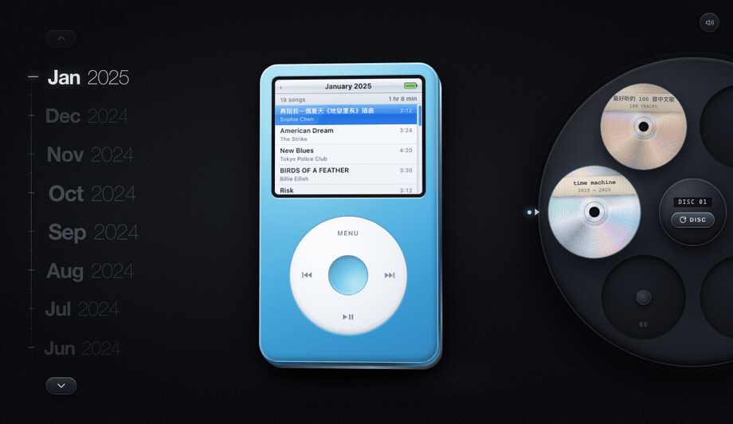

# scrobbl

In 2019, I was a sophomore in college. Every month, my friend Vivian created a monthly playlist, tracking what she listened to that month.

It's often the case that you hear a song from years ago, and it reminds you of that place and time. It's like a time machine.

For 7 years, I've compiled these monthly playlists.

For this year's holiday vibe-coding fun, I made an interactive iPod site to listen to them (except the listening doesn't work currently RIP)!



## Running locally

```sh
npm install
npm run dev
```

Build the static site to `dist/`:

```sh
npm run build
npm run preview
```

## Updating playlists

* Playlists go in `src/data/`
* Timeline files don't need to have contiguous playlists (i.e. Jan 2019 -> next playlist Feb 2020 is fine.)
* The disc changer handles either 1) a single playlist, or 2) a list of playlists (timeline)

## Todo

* Fetch Jan 2025 - onwards playlists from Apple Music
* Integrate MusicKit - make songs playable
* Add images - cover art for playlist + songs can be a real photo from my camera roll
