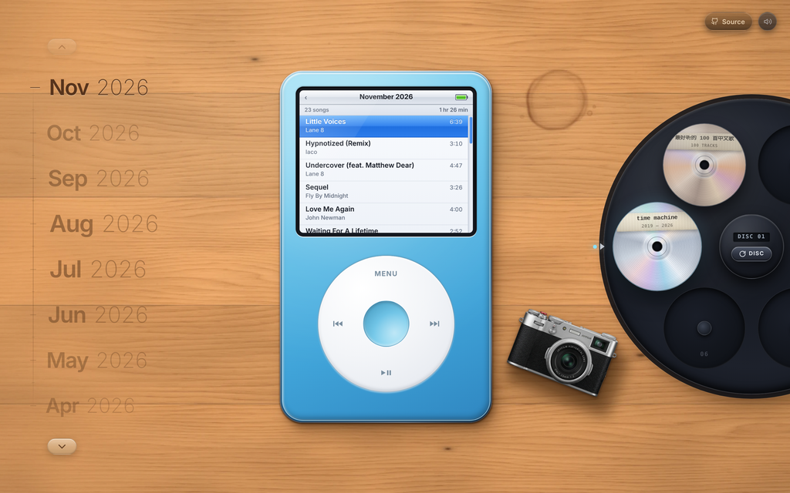

# scrobbl

In 2019, I was a sophomore in college. Every month, my friend Vivian created a monthly playlist, tracking what she listened to that month. I thought that was a great idea.

When you hear a song from years ago, it reminds you of that place and time. It's like a time machine.

For 7 years, I've compiled these monthly playlists.

For this year's holiday vibe-coded fun, I organized these playlists into a timeline.

* Left side - quick access to MONTH-YEAR
* iPod - click song to play (embedded YouTube video)
* Camera module - photos from that month



Other cool functionality:
* Film simulations on the camera - click `Q` to apply film sims
* Buttons on the iPod are functional
* Disc changer (I loaded another one, a generic playlist of 100 top Chinese songs)

## Running locally

```sh
npm install
npm run dev
```

Build the static site to `dist/`:

```sh
npm run build
npm run preview
```

## Updating playlists

* Playlists go in `src/data/`
* Timeline files don't need to have contiguous playlists (i.e. Jan 2019 -> next playlist Feb 2020 is fine.)
* The disc changer handles either 1) a single playlist, or 2) a list of playlists (timeline)
* After adding new tracks, populate their `youtubeId` fields with:

```sh
npm run populate-youtube
```

Sadly, YouTube bans embedding most tracks.

## Adding camera roll photos

The JOYFILM camera next to the iPod displays photos for the active playlist's month (`YYYY-MM`). Photos are stored in the private `scrobbl-photos` R2 bucket and served via `src/worker.ts` at `/music/photos/YYYY-MM/<file>`.

1. Put your compressed images into a temporary folder organized by `YYYY-MM/` (e.g., `./incoming/2026-11/01-thanksgiving.webp`) and upload them to R2:

```sh
npm run upload-photos -- ./incoming
```

2. Add the entries to `src/data/photos.json` (keyed by `YYYY-MM`, with optional `date`, `caption`, `filmSim`, and `meta`):

```json
{
  "2026-11": [
    {
      "src": "/photos/2026-11/01-thanksgiving.webp",
      "date": "2026.11.26",
      "caption": "thanksgiving spread",
      "meta": "23mm F2.0"
    }
  ]
}
```
